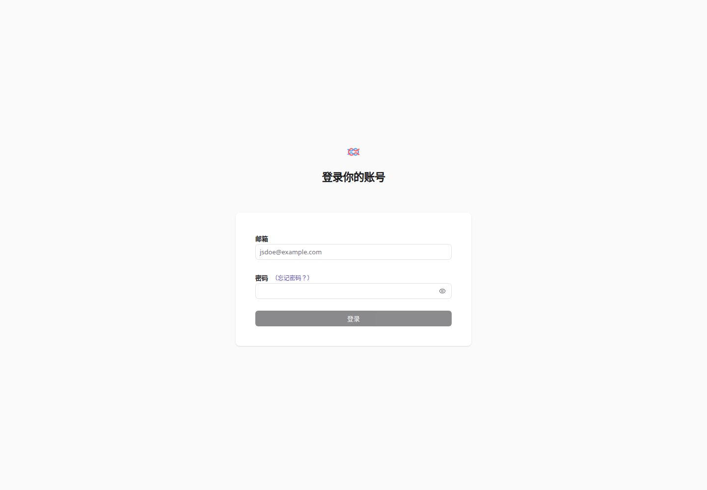

# Langfuse 中文界面

给官方 Langfuse 加一层离线简体中文界面。无需重建 Docker 镜像，也无需迁移数据库。

这是独立社区浏览器扩展，与 Langfuse 官方无隶属关系。首版面向 **Langfuse 4.70.0** 的常用界面，**不是全站完整汉化**。



## 安装

适用于 Chrome、Edge 等支持 Manifest V3 扩展的桌面浏览器。

1. 从 [Releases](https://github.com/zleo-ai/langfuse-zh-ui/releases) 下载 ZIP，解压到一个长期保留的目录。
2. 打开 `chrome://extensions`（Edge 为 `edge://extensions`），启用「开发者模式」。
3. 点击「加载已解压的扩展程序」，选择含 `manifest.json` 的目录。
4. 打开你的 Langfuse 网页，点击浏览器工具栏的扩展按钮，再点「切换为中文」。

点击「恢复英文」即可撤销本页翻译。客户端内跳转后继续生效；**整页刷新、重新打开网页后，需要再次点击启用**。本版本有意使用按次授权的 `activeTab`，不申请所有网站的常驻访问权限。

Codex 等应用内嵌浏览器未验证扩展安装能力，请用 Chrome 或 Edge。Firefox 与 Safari 未测试。

## 覆盖范围

- 登录页：邮箱、密码、登录、找回密码。
- 组织与项目入口、侧栏导航、可观测性、提示词管理、评估、设置。
- 常用按钮、标签、表头、搜索框占位文字、分页控制与时间筛选。
- 识别动态插入的界面元素；支持恢复原文。

保持原文：输入框的值、代码区、编辑器、Markdown 展示区、数据表格内容、详情页的用户命名标题和实体链接。翻译采用精确词典匹配，没有模型调用或自动翻译服务。

仍可能显示英文：长说明、校验错误、图表文案、部分复杂筛选器和新版本新增的文案。控件里的自定义名称如果与词典中的界面词完全相同，仍存在歧义；遇到这种情况可恢复英文核对。服务端日志、API、SDK、用户提交的数据不会被修改。

## 权限与数据

只有 `activeTab` 和 `scripting` 权限：用户点击扩展后，在当前网页注入本地词典与翻译代码。通过应用路径配合页面标题或 Langfuse 官网链接识别目标页面。不读取密码值、不发送网络请求、不保存页面正文、不上传遥测、不调用外部翻译接口。

此识别用于避免误用，不是身份认证机制。请在自己的 Langfuse 页面上使用。

## 开发

需要 Node.js 22+ 和 `zip`。

```sh
npm ci
npx playwright install chromium
npm test
npm run build
```

也可以用已有 Chrome 运行测试：`CHROME_PATH=/path/to/chrome npm test`。

输出目录为 `dist/langfuse-zh-ui/`，安装包为 `dist/langfuse-zh-ui-0.1.0.zip`。包中只有扩展文件、README 和许可证。

补译请编辑 `extension/dictionary.js`。只添加真实界面文案，避免添加用户提示词或回复样例。修改元素选择范围时，应补充「同样的英文出现在用户数据中仍保持原文」的测试。

## 社区方案调研

核查日期：2026-10-29。

| 方案 | 核查结果 |
| --- | --- |
| [leon30083/langfuse-zh](https://github.com/leon30083/langfuse-zh) | 浏览器汉化插件。最后代码推送为 2025-11-28；manifest 有乱码，默认地址规则未覆盖通用登录页，无发布包。 |
| [yaxzh/langfuse-zh](https://github.com/yaxzh/langfuse-zh) | 原生简体中文社区分支，README 标明基于 4.30.0，提供社区 Docker 镜像。不能把它当作官方 4.70.0 的同版本替换。 |
| [Micdiane 的导航汉化分支](https://github.com/Micdiane/langfuse/tree/feat/i18n-navigation-zh-cn) | 2026-10-26 增加导航层中文和语言选择；提交说明明确不覆盖导航之外的界面。 |

本项目从零实现，只参考上述方案的公开说明来比较交付形式，不复制其代码或词典。Langfuse 名称与商标属于原权利人。

## License

MIT，见 [LICENSE](LICENSE)。
